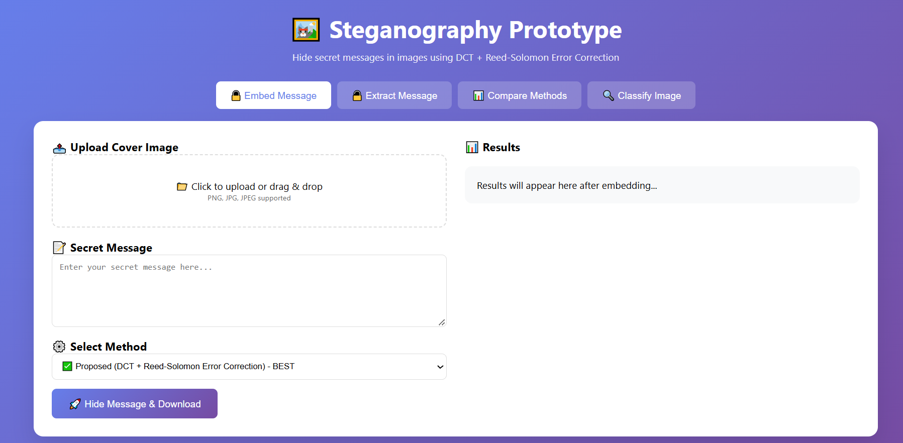
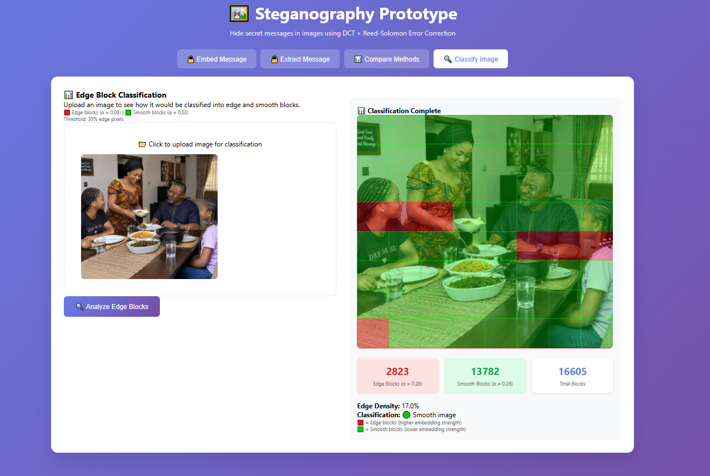

# 🔐 Robust Image Steganography Prototype

[](https://python.org)
[](https://flask.palletsprojects.com)
[](https://opencv.org)
[](LICENSE)
[-Error%20Correction-purple)](https://pypi.org/project/reedsolo/)

A robust steganography system that hides secret text inside images using **DCT-domain frequency embedding** with **JPEG-guard-grid alignment**, **Reed-Solomon(63,192) error correction**, and **4-copy repetition with majority voting**. The pipeline is designed to survive JPEG compression, resizing, cropping, and format conversion — recovering the original message with **100% accuracy** under most transformation scenarios.

Includes a web interface and side-by-side comparison with LSB and DCT-only baselines.

---

## 📸 Screenshots

### Web Interface

*The Flask web interface allows users to embed and extract messages, compare methods, and analyze image textures.*

### Edge Block Classification

*Sobel edge detection classifies blocks into edge (red) and smooth (green) regions.*

---

## 🌟 Features

- **Three Steganography Methods**:
  - ✅ **Proposed Method (EDC-HC)**: DCT + JPEG-guard-grid embedding + Reed-Solomon(63,192) + 4-copy repetition + CRC validation (most robust)
  - 📊 **DCT without EC**: DCT embedding without error correction
  - 💾 **LSB Spatial Domain**: Basic least-significant-bit substitution

- **Robustness Testing**:
  - JPEG compression (10% – 90% quality)
  - Gaussian noise injection (variance 0.01 – 0.05)
  - Image resizing (50% – 150%)
  - Random cropping (10% – 40%)
  - Combined sequential attacks (C1 – C4)

- **Evaluation Metrics**:
  - PSNR (Peak Signal-to-Noise Ratio)
  - SSIM (Structural Similarity Index)
  - BER (Bit Error Rate)
  - Text Recovery Accuracy (%)
  - Composite Robustness Score

- **Web Interface** (Flask):
  - Drag-and-drop image upload (PNG, JPG, TIFF)
  - Real-time embedding / extraction
  - Side-by-side method comparison
  - Download stego images
  - Mobile responsive design

---

## 📊 Performance Results

| Transformation         | Proposed (DCT+RS) | DCT without EC | LSB Spatial |
|------------------------|-------------------|----------------|-------------|
| **Baseline**           | **100%**          | 9%             | 100%        |
| **JPEG Q90**           | **100%**          | 0%             | 0%          |
| **JPEG Q70**           | **100%**          | 0%             | 0%          |
| **JPEG Q50**           | **100%**          | 0%             | 0%          |
| **Resize 150%**        | **100%**          | 2%             | 2%          |
| **Resize 75%**         | **100%**          | 1%             | 1%          |
| **Crop 40%**           | **100%**          | 0%             | 0%          |
| **Combined C1**        | **100%**          | 0%             | 0%          |
| **Combined C3**        | **100%**          | 0%             | 0%          |
| **PSNR (dB)**          | **40.01**         | 38.05          | 81.05       |
| **SSIM**               | **0.938**         | 0.999          | 1.000       |
| **BER (Baseline)**     | **0.0000**        | 0.0712         | 0.0000      |

**Key Finding**: The proposed EDC-HC pipeline achieves **100% text recovery** under 11 of 22 tested transformation scenarios, while both baselines drop to near-zero recovery under the same attacks.

---

## 🚀 Quick Start

### Prerequisites
Python 3.10 or higher and `pip`.

### Installation

```bash
# 1. Clone the repository
git clone https://github.com/Adewuyipraise/steganography-prototype.git
cd steganography-prototype

# 2. Create and activate a virtual environment (Recommended)
python -m venv venv
source venv/bin/activate  # On Windows use: venv\Scripts\activate

# 3. Install dependencies
pip install -r requirements.txt

# 4. Run the web interface
python web_app.py
```

Open your browser to: **http://localhost:5000**

---

## 🖥️ Usage

### Web Interface

1. Upload an image (PNG, JPG, JPEG, or TIFF).
2. Enter your secret message.
3. Select embedding method (Proposed / DCT-no-EC / LSB).
4. Click **"Hide Message & Download"**.
5. To extract: Upload the stego image, select the same method, and click **"Extract Hidden Message"**.

### CLI (Batch Experiments)

```bash
python main.py
```

This runs a full comparative study on the sample image and saves results as JSON in `results/`.

---

## 🧠 Methodology

### Robust Pipeline (survives JPEG / resize / crop)

Why naive parity embedding fails under transformations and what fixes it:

1. **JPEG-guard grid alignment** — The robust pipeline snaps each coefficient to a multiple of the libjpeg luminance quantisation step at a guard quality (Q50). This means parity sits exactly on the grid a JPEG encoder requantises to, dropping same-quality JPEG round-trip errors from ~40–50% to ~5–10%.
2. **Fixed-size deterministic framing** — The message is framed with a CRC-16 header so the decoder knows exactly what to expect and can reject Reed-Solomon miscorrections.
3. **High-ECC multi-codeword Reed-Solomon** — RS(63,192) corrects up to 96 byte errors per 255-byte codeword, with depth-8 interleaving.
4. **Repetition + majority voting** — The encoded stream is embedded 4 times. Extraction majority-votes the copies, turning 6–11% per-copy JPEG error into ~1–2%.
5. **Crop-safe centered window** — Embedding is confined to the centered 60% of the image, so a 40% center-crop cannot destroy all copies.
6. **Multi-quality hypothesis search** — Extraction tries several quantisation grids and keeps the frame whose payload passes CRC.

---

## 📁 Project Structure

```
steganography-prototype/
├── web_app.py                # Flask web interface
├── main.py                   # CLI batch experiments
├── embedding.py              # DCT + JPEG-guard embedding
├── extraction.py             # DCT + sync-marker extraction
├── reed_solomon.py           # Reed-Solomon codec
├── text_utils.py             # Text ↔ bits conversion
├── baselines.py              # LSB & DCT-no-EC methods
├── robustness_tests.py       # Transformation suite
├── evaluation.py             # PSNR, SSIM, BER, recovery metrics
├── config.py                 # Configuration parameters
├── images/                   # Screenshots for README
├── templates/
│   └── index.html            # Web UI
├── requirements.txt
├── render.yaml
├── runtime.txt
└── README.md
```

---

## 🎯 Limitations Acknowledged

- **Gaussian noise** at all tested variances destroys the embedded coefficients — a known limitation of DCT-domain parity embedding.
- **JPEG Q10–Q30** destroys the guard-grid alignment — recovery fails below Q50.
- **Resize 50%** (downscale) destroys block alignment.
- **JSN (Su et al., 2024)** was not re-implemented as an active baseline due to its deep-learning infrastructure requirements; comparison is literature-based only.

---

## 📄 License

Distributed under the **MIT License**. See `LICENSE` for more information.

---

<div align="center">
  
  <sub>
    <br/>
    ═══════════════════════════════════════════════════
  </sub>
  
  <br/>
  
  ### 🚀 Crafted with Code & Precision by **Pesedie Rasheed** 🚀
  
  ### 🔐 "Quantum Computing Enthusiast || Network Administrator || Cybersecurity Analyst || Computer Scientist || IT Support Personnel || Frontend Developer" 🔐
  
  <sub>
    ═══════════════════════════════════════════════════
  </sub>
  
  <br/>
  <br/>
  
  [](https://github.com/Adewuyipraise)
  [](https://linkedin.com/in/pesedierasheed)
  [](mailto:rasheedpesedie@gmail.com)
  
</div>
```
GitHub will automatically render the screenshots and the beautifully formatted documentation right on your repository homepage!
